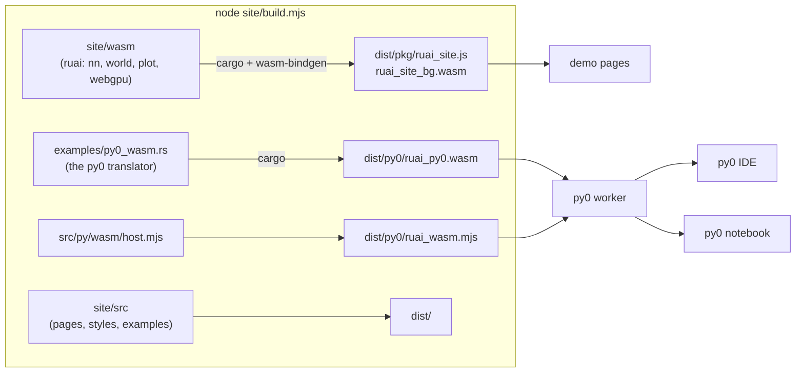

# The ruai website

`site/` is a static website that runs ruai in the browser: a py0 IDE, a py0
notebook, and demos of the neural network engine, the reinforcement-learning
environments and the plots. Everything is compiled to WebAssembly and runs on
the visitor's machine. There is no server, and the GPT demo trains on the GPU
through WebGPU.

## Build and run

`run.sh` at the root of the repository does every task:

```bash
./run.sh setup         # install the wasm32 target and wasm-bindgen-cli 0.2.130
./run.sh check         # are the tools there?
./run.sh build         # → site/dist/ (the wasm modules and the pages)
./run.sh serve [port]  # http://localhost:8000
./run.sh dev [port]    # build, then serve
./run.sh watch [port]  # serve, and copy the pages again whenever site/src changes
./run.sh pages         # copy the pages again without rebuilding the wasm
./run.sh test          # compile and run every py0 example with the built compiler
./run.sh size          # sizes of the built files
./run.sh clean         # remove site/dist and site/wasm/target
```

These commands run the Node.js scripts in `site/`: `build.mjs`, `serve.mjs`
and `test.mjs`. You can also run the scripts directly. To build the site you
need cargo with the `wasm32-unknown-unknown` target, `wasm-bindgen-cli`
0.2.130, and Node.js 18 or newer. No npm packages are needed.

## Publishing on GitHub Pages

`.github/workflows/pages.yml` builds the site on every push to `main` that
changes `site/`, `src/` or `Cargo.toml`, and deploys `site/dist/` with
`actions/deploy-pages`. You can also start it by hand from the Actions tab. You
only need to set it up once: in the repository's **Settings → Pages**, set
**Source** to **GitHub Actions**.

All paths in the site are relative, so it works under a project URL such as
`https://<user>.github.io/ruai/`. The pages use hash routes (`#/ide`,
`#/notebook`, …), so no server rewrites are needed.

## How it fits together



- **`site/wasm/`** is a small crate (`cdylib`) that depends on ruai with
  `webgpu`, `world` and `plot`. Each module holds the state of one demo in a
  `thread_local` and exports the functions its page calls through
  wasm-bindgen:
  - `playground.rs`: the classifier;
  - `fit.rs`: curve fitting;
  - `descent.rs`: the optimizer race;
  - `gpt.rs`: the GPT and the matmul benchmark;
  - `cartpole.rs`, `mountaincar.rs`, `lake.rs` and `gym.rs`: reinforcement learning;
  - `gallery.rs`: the plots.
- **`site/src/`** is the page code. `app.mjs` is a hash router that mounts one
  module of `demos/` at a time. The libraries are in `lib/`:
  - `ruai.mjs` loads the wasm module once and gives `draw()` for `ruai::plot` figures;
  - `py0.mjs` and `py0-worker.mjs` run py0;
  - `editor.mjs` provides the editors;
  - `notebook.mjs` handles notebook execution and `.ipynb`;
  - `markdown.mjs` renders Markdown cells;
  - `envs.mjs` draws the environments.
- **py0** programs compile and run in a Web Worker. The compiler is
  `ruai_py0.wasm` (the translator built for wasm32), and the compiled WasmGC
  module runs on `ruai_wasm.mjs`. Because the work happens off the page's
  thread, the stop button can end an endless loop by terminating the worker.
- **The editor** is Monaco, the editor of VS Code, loaded from jsDelivr
  (`monaco-editor@0.52.2`). When it cannot be loaded, for example offline,
  the pages fall back to a plain text area with the same keys.

## The notebook

py0 compiles whole programs, so a notebook cannot keep a live interpreter
between cells. To run cell *k*, the notebook compiles code cells 0…*k* as one
program and prints a marker line before each cell. The output is then split at
the markers, and each part goes to its cell. Variables, functions and classes
from earlier cells are therefore defined, just as in Jupyter. The earlier cells
are run again each time, which takes a few milliseconds.

When the last line of a run cell is an expression, the notebook prints its
`repr` after a second marker, and the page shows it as `Out[n]`. py0 rejects
expression statements that have no effect. For that reason, a last expression
that is not displayed is dropped, unless it is a call. If the displayed
expression cannot be printed, the notebook compiles the program again without
the display. A compile error reported at `line N` of the program is mapped
back to the cell and the line inside it.

**Export .ipynb** writes nbformat 4.5:

- output text becomes `stream` outputs;
- the last expression becomes an `execute_result`;
- a Python traceback becomes an `error` output.

py0 is a subset of Python, so the exported notebooks also run in Jupyter on
CPython. **Open .ipynb** reads the code and Markdown cells of any notebook,
along with their text outputs.

## Adding a demo

1. In `site/wasm/src/`, add a module and declare it in `lib.rs`. Export its
   functions with `#[wasm_bindgen]`, and keep its state in a `thread_local`.
2. In `site/src/demos/`, add a page module with
   `export async function mount(el)`. It should return a function that stops
   its animations.
3. Add it to `PAGES` in `site/src/app.mjs` and to `BLURBS` in `demos/home.mjs`.
4. To add a py0 example to the IDE, put a `.py` file in `site/src/py0/examples/`.
   It must compile with `ruai py wasm`.
